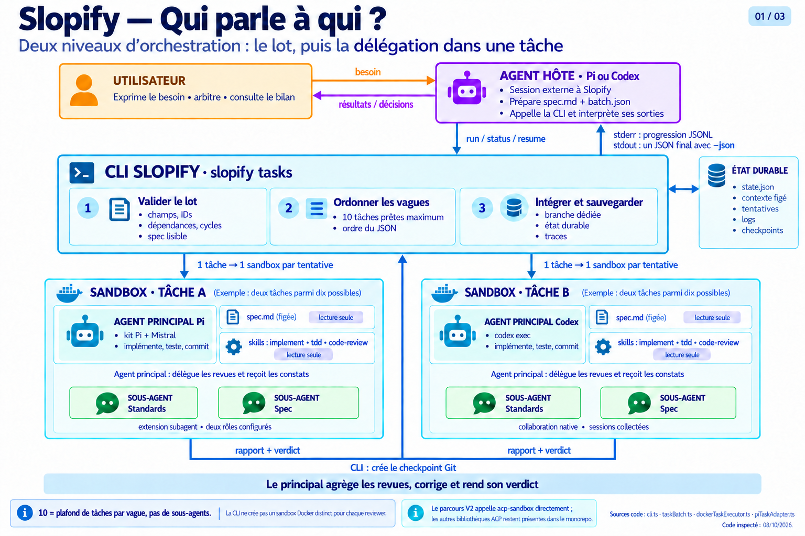
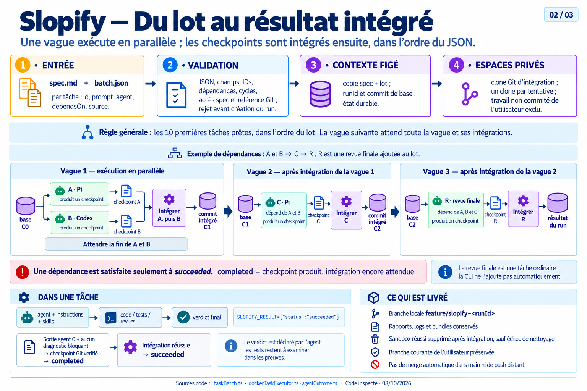
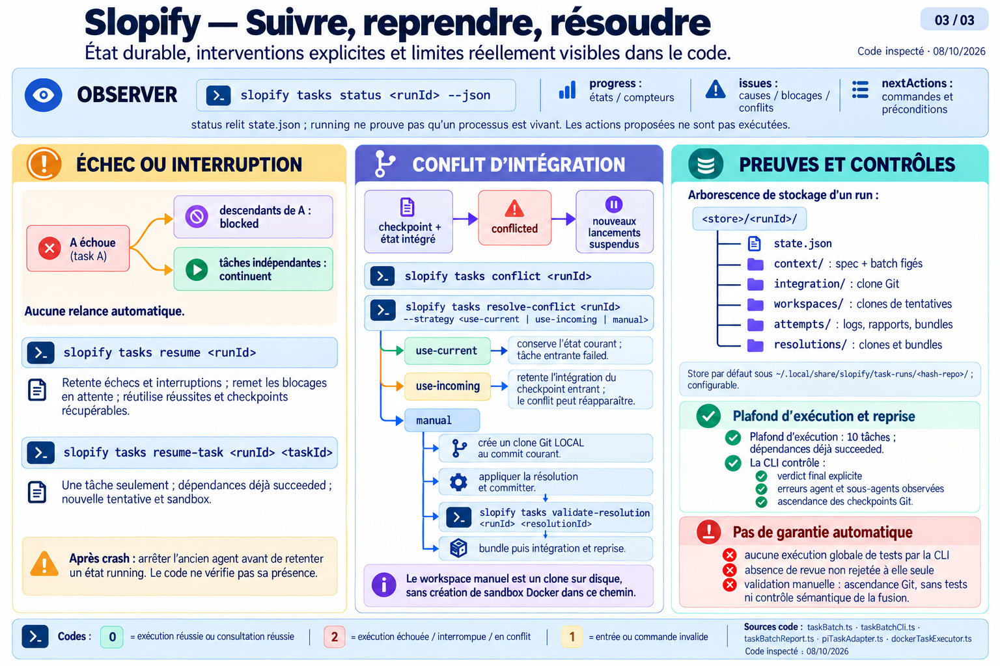

# Slopify V2

Slopify reçoit une spec et un lot JSON préparés à l’extérieur, puis exécute les
tâches avec Pi ou Codex, soit en Docker Sandboxes (mode `sandbox` par défaut),
soit directement sur la machine (mode `local`, sans Docker). Dès qu’une place se
libère, la première tâche prête dans l’ordre du JSON démarre, avec au plus dix
tâches actives. Chaque tâche garde sa base épinglée au démarrage. Les checkpoints
s’intègrent un à un dès leur disponibilité ; leurs descendants deviennent alors
éligibles. Un échec bloque seulement ses descendants, sans relance automatique.

## Fonctionnement en images

Les trois planches ci-dessous illustrent le fonctionnement historique par vagues.
L’ordonnanceur actuel admet jusqu’à **10 tâches prêtes en parallèle**, chacune avec
son agent principal et son exécution isolée. En mode sandbox seulement, elles
s'appuient sur des sandboxes Docker. Les sous-agents de revue ne sont pas comptés
dans ce plafond.

### 1. Utilisateur, agent hôte, CLI et sous-agents



### 2. Du lot au résultat intégré



### 3. Suivi, reprises et conflits



Voir les [sources du code et les précisions de lecture](docs/images/slopify/README.md).

## Installation et utilisation

Prérequis communs : Node.js >= 22.19, npm, Git et agents Pi/Codex configurés.
Le mode `local` utilise leurs configurations natives et **ne nécessite pas Docker**.
Le mode `sandbox` requiert Docker Sandboxes (`sbx`) et les skills officiels
`implement`, `tdd`, `code-review` disponibles en lecture seule.

```bash
scripts/install.sh      # npm install si besoin + build + symlink slopify dans ~/.local/bin (PATH)
slopify --help
slopify init --host all --yes
slopify tasks run batch.json --cwd /chemin/du/depot --mode local --json  # sans Docker
slopify tasks run batch.json --cwd /chemin/du/depot --mode sandbox --json  # défaut
slopify tasks status <run-id> --cwd /chemin/du/depot --json
slopify tasks resume <run-id> --cwd /chemin/du/depot --json
```

`scripts/uninstall.sh` retire le symlink et le bloc PATH correspondant du fichier
rc du shell (dist/ est conservé ; `npm run clean` le supprime). L'install
expose un symlink vers `apps/cli/dist/src/cli.js` dans le repo : la CLI charge
les assets `plugin/` et `init/` depuis le package `@slopify/project-init`,
indépendamment du répertoire de travail courant.

Sans installation globale : `npm run slopify -- tasks run batch.json --json`.

`slopify init` prépare uniquement le projet ciblé (`--cwd`) pour la V2 : exemples
dans `.scratch/slopify/`, conventions locales et skill hôte Pi/Codex. `--host`
accepte `pi`, `codex` ou `all`; `--yes` choisit `all` par défaut. Une relance
réécrit tous les fichiers possédés par init, sans sauvegarde, et préserve les autres.
Le choix d'hôte reste interactif sans `--host`, mais le pull project-scope de
`mattpocock/skills` est toujours automatique et non interactif. Il est géré par la
CLI `skills`; son échec est un avertissement. Init ne consulte ni ne modifie le
store global `sbx`.

Cette commande adapte l'intention de l'issue historique #45 au contrat V2 : aucun
asset `.acp`, Vibe ou Copilot et aucune restauration des anciennes commandes. Les
ADR historiques restent archivées ; l'ADR dual-mode de la V2 remplace les
anciennes décisions exclusivement Docker/ACP.

Le lot contient `specFile`, des `defaults` facultatifs et `tasks`. Init propose
`agent: "codex"`, `model: "gpt-6-luna"`, `effort: "medium"` comme base ; l'Agent
Host choisit les paramètres par tâche et peut les surcharger. `model` et `effort`
s'appliquent aux tâches Codex. Slopify valide tout le lot avant lancement et
transmet les prompts sans réécrire les instructions de skills.
Il conserve l’état durable, les rapports et la branche `feature/slopify-<run-id>`
sans modifier la branche de travail de l’utilisateur.

Codes : **0** pour une exécution ou consultation réussie, **2** pour une exécution
échouée, interrompue ou en conflit, **1** pour une erreur d’entrée ou de commande.
Les anciens `list`, `run <pipeline> <prompt>` et `resume --agent` sont retirés.

`run` annonce son identifiant et son avancement sur stderr. `tasks status` fournit
les compteurs, les causes d’échec et blocages, les rapports et les commandes utiles
pour la suite, en texte ou JSON.

Voir la commande `slopify tasks --help` et le
[guide Pi](docs/agents/coordinator-pi.md) pour les reprises et conflits.

## Monorepo et validation

`slopify` expose uniquement les lots V2. Le monorepo contient `apps/cli`
et les packages fonctionnels `execution`, `execution-local`, `execution-sandbox`,
`task-batches`, `git`, `activity`, `agent-pi`, `agent-codex` et `project-init`.
Les quatre anciens packages ACP/V1 ne font plus partie du build V2.

Le package d'exécution est sélectionné pour **tout un run** : `--mode` a priorité
sur `.slopify/runtime.yaml`, puis `sandbox` est utilisé par défaut. La reprise
conserve le mode enregistré dans le run. Les tentatives locales opèrent dans des
clones Git privés, jamais dans les modifications non commitées du workspace.
Une reprise locale refuse toute tentative dont l'agent ou ses descendants ne
sont pas confirmés arrêtés (voir la [spécification corrective #155](https://github.com/maurice30120/Slopify/issues/155)).

```bash
npm run build
npm test
```

La suite automatisée et la CI n'utilisent **ni Docker ni fournisseurs réels**.
Pour un changement ciblé, préférer d'abord le test concerné (par exemple
`npm run test -w @slopify/task-batches -- dist/test/localMode.test.js`).

Les smoke tests réels ne sont **jamais exécutés en CI** : sur le poste de
développement uniquement, lancer `npm run smoke:local` (sans Docker) ou
`npm run smoke:docker` (Docker Sandboxes). Les deux nécessitent des accès Pi/Codex
et conservent leurs preuves dans un dépôt temporaire. Voir [Tests et smoke tests](docs/testing.md).
